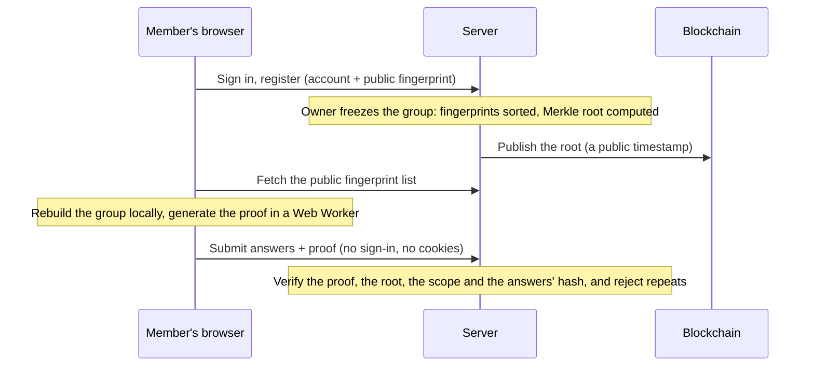

# NullForm

**Authenticated, anonymous forms.** Only eligible, signed-in people can *register* for a form. Answers are then
submitted *without signing in*, with a zero-knowledge proof that the sender is one of the registered members, and not
which one.

Live: <https://nullform.engliz.dev>

> **Status: proof of concept.** It uses audited building blocks (Semaphore, Groth16) but the integration has not been
> independently reviewed. Read [What it does not protect](#what-it-does-not-protect) before relying on it.

## How it works

Two steps that never meet:

1. **Register (not anonymous).** The owner decides who is eligible: specific email addresses, an email domain, or
   GitHub users. Eligible people sign in and register. Their browser creates a secret and sends only a public
   fingerprint (an identity commitment).
2. **Answer (anonymous).** Registered members answer without signing in. Each answer carries a zero-knowledge proof of
   membership. The server verifies it, and a per-form nullifier stops anyone answering twice.



Anyone can open a form's **audit page** to re-check the group, the on-chain anchor and every receipt in their own
browser. Answers are never shown there; only the form's owner can read them.

### Design choices worth knowing

- **One identity per form.** The browser keeps one master secret and derives each form's Semaphore identity with HKDF
  over the form id, so a member's fingerprint can't be linked across forms.
- **The answers are bound to the proof.** The signal is a hash of the canonical JSON of the answers, so a proof can't be
  replayed with different content. Client and server share one canonicalisation, covered by test vectors.
- **Leaves are sorted at freeze,** so insertion order leaks nothing, and the group is immutable afterwards.
- **A delay between freezing and answers opening** blunts timing correlation with registration.
- **Circuit files are self-hosted** (`public/artifacts`), pinned to the build, not fetched from a third party.
- **The frozen root is anchored on-chain** as a zero-value self-transaction carrying the root as calldata (no contract).
  It is best effort: a failed anchor never blocks a freeze, and the owner can retry.

## What it does not protect

NullForm protects *who* answered, not *what* was answered, and only the answers are anonymous.

- **Registration is not anonymous.** The site knows which account registered. What stays hidden is which registered
  member sent which answer.
- **Answers are visible to the owner,** are stored unencrypted, and free text can identify someone by style or detail.
- **Network traces.** Hosting providers see IP addresses and timing. The practical way to be identified is to register
  and answer from the same address. Answer from a different network, or use Tor Browser (strongest), a VPN or a proxy.
- **A hostile or compromised host** could serve altered code that steals your secret. The code is open source and the
  circuit files are pinned, but nothing lets you verify what you were served.
- **Small groups** give weak anonymity (owners are warned below 20). A group of one is identified outright.
- **Fake members and throwaway accounts.** An owner can register fake identities (visible on the audit page, not
  prevented). With "anyone with an account" eligibility, one person can register many times.
- **A lost secret** means you can't answer. The app shows a backup string when you register; anyone holding it can
  answer as you.
- **Coercion** is out of scope: a member can prove which answer is theirs by revealing their secret.
- **Email sign-in links** only work in the browser that asked for them, and some mail scanners use them up.

## Stack

| Part | Choice |
|---|---|
| Protocol | [Semaphore](https://semaphore.pse.dev) v4 (Groth16, tree depth 10, up to 1,024 members per form) |
| Frontend | Vite, React, TypeScript. Runtime dependencies are only React, `supabase-js` and the Semaphore packages |
| Server | Vercel Node functions (`api/`, handlers in `server/`) |
| Data and auth | Supabase: Postgres with row-level security, email sign-in links and GitHub sign-in |
| Anchoring | `viem`, server side only. Sepolia in production |
| Hosting | Vercel (see [docs/DEPLOY.md](docs/DEPLOY.md)) |

Registration, freezing, submissions and anchoring go through SQL functions that only the server's service role can run.
The browser's key can read only what row-level security allows, and owners can edit their own drafts and allowlists
directly under the same policies. The schema and policies are in `supabase/migrations`.

## Repository layout

```
src/        React app: pages, identity derivation, proving and verification workers, audit and results logic
api/        Vercel function entry points (thin wrappers)
server/     Handlers: register, submit, lifecycle (open, freeze, anchor, close), auth providers, anchoring
shared/     Code used by both sides: canonical JSON, hashing, form schema, anchor calldata format
supabase/   Migrations and local configuration
tests/      Unit and integration tests
scripts/    export-anchors.mjs, which writes the public anchors.json mirror
public/     Self-hosted circuit files, icons and the theme script
docs/       Deployment guide
```

## Run it locally

You need Node 24, a container runtime (Docker or Podman) and the [Supabase CLI](https://supabase.com/docs/guides/cli).

```sh
npm ci

# Placeholders so the local Supabase config can start; GitHub sign-in isn't exercised locally.
printf 'SUPABASE_AUTH_GITHUB_CLIENT_ID=placeholder\nSUPABASE_AUTH_GITHUB_CLIENT_SECRET=placeholder\n' > supabase/.env

# Local Postgres, Auth, REST and a mail catcher (the unused services are skipped).
supabase start -x imgproxy,postgres-meta,studio,logflare,vector,edge-runtime,storage-api,realtime,supavisor

# Server-side settings for the dev API (never committed). Submissions open 60 s after a freeze.
supabase status -o env | awk -F= '/^(API_URL|SECRET_KEY)=/ {gsub(/"/,"",$2); print (($1=="API_URL") ? "SUPABASE_URL" : "SUPABASE_SECRET_KEY") "=" $2}' > .env.local
echo "OPEN_DELAY_SECONDS=60" >> .env.local

npm run dev          # http://localhost:5173
```

Sign-in emails land in the local mail catcher at <http://127.0.0.1:54324>. Open the link in the same browser you
requested it from.

To try on-chain anchoring without a testnet, start a local chain and point the dev API at it:

```sh
docker run --rm -p 8545:8545 ghcr.io/foundry-rs/foundry "anvil --host 0.0.0.0"
# then add to .env.local:  ANCHOR_CHAIN=local  and  ANCHOR_PRIVATE_KEY=<Anvil's first dev account key>
```

### Tests

```sh
npm run typecheck
npm test             # unit tests, plus integration tests against the local Supabase stack
```

The integration tests sign in for real, through the mail catcher, and generate real proofs. The chain tests run only if
a local chain is listening on port 8545 and are skipped otherwise. A browser end-to-end flow (register, freeze, submit,
audit) was run by hand against a production build; it is not yet part of CI.

## Measured

One desktop machine and headless Chromium, so treat these as ballpark. Phones have not been measured.

| | |
|---|---|
| Generate a proof in the browser (Web Worker) | about 0.4 s warm, 0.7 s cold |
| Verify a proof on the server | about 20 to 50 ms |
| Serverless cold start (stub measured on Vercel's US East region) | about 1.2 to 1.4 s end to end |
| App bundle | about 0.55 MB (about 175 KB gzipped), plus a 0.45 MB proving worker |
| Circuit files, loaded on demand | 1.8 MB `.wasm`, 2.4 MB `.zkey` |

## Deploying

See [docs/DEPLOY.md](docs/DEPLOY.md) for the Supabase, Vercel and GitHub Actions setup, the environment variables and
the secrets each one needs.

## License

[MIT](LICENSE)
